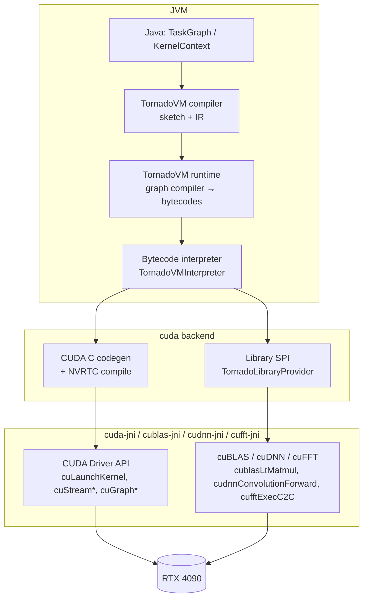
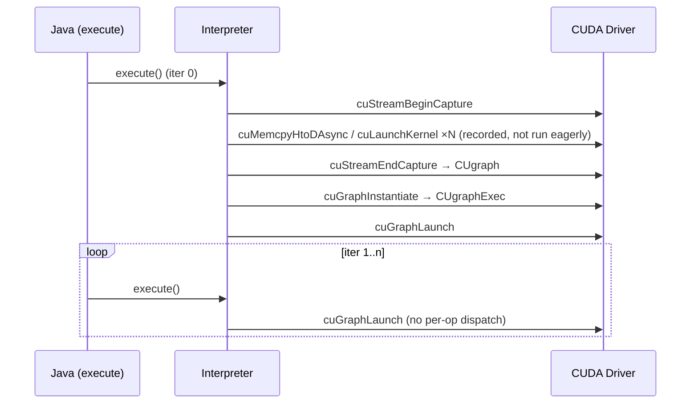


This article was first published on the TornadoVM blog on 10 July 2026. CUDA streams, CUDA Graphs, the Tensor Core MMA intrinsics and the cuBLAS, cuDNN and cuFFT library tasks it describes are all available in the latest release, TornadoVM 8.2.0, on the `cuda` backend. Some internals have changed since: TornadoVM 6.0.0 retired the `ptx` backend and moved the CUDA driver bindings from JNI to the FFM API, and in 8.0.0 TornadoVM's own compiler, TC, replaced Graal.


For most of its life, TornadoVM answered a single question well: *can we take ordinary Java methods, JIT-compile them to GPU kernels, and run them without the developer writing a line of CUDA?* The answer was yes — you annotate a loop with `@Parallel`, wrap it in a `TaskGraph`, and the runtime generates PTX (or OpenCL, or SPIR-V) and schedules it.

That model has a ceiling. A generated kernel is only ever as good as the compiler that generated it. Real CUDA applications do not live on generated kernels alone; they live on **CUDA Graphs** to amortize launch overhead, on **multiple streams** to overlap copies with compute, on **cuBLAS/cuDNN/cuFFT** for the kernels NVIDIA has spent a decade tuning, and on **Tensor Cores** for the matrix-multiply throughput that dominates modern AI. Until recently, reaching any of these from Java meant dropping to JNI by hand and giving up TornadoVM's memory management and scheduling.

## 1. TornadoVM in a Nutshell

TornadoVM is a heterogeneous programming framework that JIT-compiles Java bytecode to GPU and accelerator code through its own compiler pipeline. You do not write kernels in a DSL string; you write Java, and the runtime lowers it.

Three abstractions matter for the rest of this article:

- **`TaskGraph`** — a declarative description of data movement and computation: which host arrays are copied to the device, which methods run as tasks, and which results come back. Tasks are ordinary Java method references. A `TaskGraph` is turned into an `ImmutableTaskGraph` via `snapshot()`.
- **`TornadoExecutionPlan`** — the runtime handle you actually execute. It carries execution policies: device selection, profiling, warm-up, and — new here — `withCUDAGraph()`.
- **`KernelContext`** — the lower-level, explicit programming model. Instead of `@Parallel` loops, you get thread indices (`localIdx`, `groupIdx`), shared memory (`allocateIntLocalArray`), and barriers (`localBarrier()`). This is where Tensor Core intrinsics live, because MMA is inherently a warp-cooperative operation.

Under the hood, a `TaskGraph` compiles to a **bytecode program** for a small stack interpreter (`ALLOC`, `TRANSFER_HOST_TO_DEVICE_*`, `LAUNCH`, `TRANSFER_DEVICE_TO_HOST_*`, `DEALLOC`). The interpreter walks this program and issues the corresponding backend calls. This indirection is important: it is exactly the layer that CUDA Graph capture wraps, and where the new `EXECUTION_GRAPH_BEGIN_CAPTURE` / `EXECUTION_GRAPH_LAUNCH` bytecodes were added.

TornadoVM has several backends. The NVIDIA-facing ones are **`ptx`** (the compiler emits PTX ISA directly) and the newer **`cuda`** backend used throughout this article, which emits CUDA C and compiles it at runtime with **NVRTC**, then loads the module with the CUDA Driver API. The `cuda` backend is what binds the vendor libraries and Tensor Core intrinsics discussed below to a real device stream.

The keys throughout the investigation are three CLI flags: `--printKernel` (dump generated device code), `--printBytecodes` (dump the interpreter program), and `--debug` (verbose runtime). Every raw capture in this article came from one of them or from Nsight Systems.

## 2. Runtime architecture: where each feature plugs in



The five capabilities attach at three distinct layers:

- **Tensor Core MMA** is a *codegen* feature: new compiler nodes lower `KernelContext.mma*` calls to inline PTX `mma.sync` / `ldmatrix` inside the generated CUDA C (box E).
- **CUDA Streams** and **CUDA Graphs** are *interpreter/driver* features: the bytecode interpreter dispatches transfers and launches onto role streams, or records them into a graph, and the JNI calls `cuStream*` / `cuGraph*` (box G).
- **cuBLAS / cuDNN / cuFFT** are *library-SPI* features: a `libraryTask` resolves through a `ServiceLoader`-discovered `TornadoLibraryProvider` to a native library binding (boxes F/H), sharing the same device buffers and stream as the JIT kernels.

A crucial design consequence: because library tasks share TornadoVM buffers and stream, and because both streams and graphs sit *below* the task abstraction, the features **compose** — a graph can capture JIT kernels *and* a cuBLAS call together, on a multi-stream plan.

## 3. CUDA stream management

### The mechanism

A native CUDA C++ programmer overlaps a host→device copy of the next batch with the kernel of the current batch by putting them on different streams and inserting an event wait. [PR #800](https://github.com/beehive-lab/TornadoVM/pull/800) exposes the same capability to Java behind one call:

```java
TaskGraph graph = new TaskGraph("pipeline")
    .transferToDevice(DataTransferMode.EVERY_EXECUTION, input)
    .task("stage1", MyKernels::stage1, input, tmp)
    .task("stage2", MyKernels::stage2, tmp, output)
    .transferToHost(DataTransferMode.EVERY_EXECUTION, output)
    .withCUDAStreams();        // opt in to multi-stream execution
```

`withCUDAStreams()` and its inverse `withoutCUDAStreams()` are real methods on `TaskGraph` (`TaskGraph.java:1154` / `:1163`) **[verified]** — the second exists specifically so test suites can flip the flag back off safely.

Internally the `cuda` backend replaces the single default stream with **three role streams plus a COMPUTE pool** (`CUDADeviceContext.java`) **[impl]**:

```java
enum CUDAStreamType { DATA_TRANSFER_H2D, COMPUTE, DATA_TRANSFER_D2H }

// DAG-independent kernels are round-robined across a pool, because a single
// COMPUTE queue would serialise every kernel — kernel/kernel overlap needs a pool.
private static final int COMPUTE_POOL_SIZE =
        Math.max(1, Integer.getInteger("tornado.cuda.compute.streams", 4));
```

The interpreter routes each bytecode to the right stream: `enqueueWriteBuffer(...)` → the `DATA_TRANSFER_H2D` queue, kernel launches → a `COMPUTE`-pool stream, `enqueueReadBuffer(...)` → the `DATA_TRANSFER_D2H` queue. Transfers are issued non-blocking (`cuMemcpyHtoDAsync` / `cuMemcpyDtoHAsync`), and correctness across streams is preserved by lowering the data-flow graph's dependencies to `cuStreamWaitEvent(stream, event, 0)` in the JNI (`CUDACommandQueue.cpp`). An event recorded after the current task's H2D lets the next task's kernel begin without a full-device sync.

### What is and isn't verified here

The API and the stream/event Driver calls are **[verified]** present — two `cuStreamCreate` calls appear even in the single-stream cuBLAS trace of Section 5. The actual H2D↔COMPUTE *overlap* is documented here as **[impl]**: traced through the interpreter and JNI rather than captured as an Nsight timeline of overlapping streams, because no multi-stream unit test ships on `develop` and the honest thing is to say so. What a CUDA developer should take away is that the *ordering primitive* is identical to hand-written code (`cuStreamWaitEvent` on a recorded event); TornadoVM derives the events from the `Access[]` data-flow graph instead of making you place them.

## 4. CUDA Graphs

### Why graphs exist

Every `cuLaunchKernel`, every `cuMemcpyHtoDAsync`, costs CPU time to validate arguments and enqueue. For a large one-shot kernel this is noise. For an **iterative** workload — an inference loop, a time-stepping HPC solver — that re-issues the *same* sequence of dozens of small operations thousands of times, the per-launch dispatch cost becomes the bottleneck and the GPU sits idle between launches waiting on the CPU. CUDA Graphs solve this: you *capture* the sequence once into a graph, *instantiate* an executable graph, and then *replay* the entire thing with a single `cuGraphLaunch`.

### What TornadoVM records

[PR #811](https://github.com/beehive-lab/TornadoVM/pull/811) adds `withCUDAGraph()` to `TornadoExecutionPlan` **[verified]**:

```java
try (TornadoExecutionPlan plan = new TornadoExecutionPlan(graph.snapshot())) {
    plan.withCUDAGraph();
    for (int it = 0; it < iterations; it++) {
        // update inputs on host...
        plan.execute();   // it == 0 captures + launches; it > 0 replays
    }
}
```

The interpreter grew two bytecodes, and the capture wraps exactly the invariant operations. From a real `--printBytecodes` run (Section 2.3 of the evidence log) **[verified]**:

```
bc:  EXECUTION_GRAPH_BEGIN_CAPTURE  graphId=0
    bc:  TRANSFER_HOST_TO_DEVICE_ALWAYS  FloatArray@...      (matrix)
    bc:  LAUNCH  task cuBLASGraph.mutateData                 (JIT kernel)
    bc:  TRANSFER_HOST_TO_DEVICE_ALWAYS  FloatArray@...      (vector)
    bc:  LAUNCH  task cuBLASGraph.cublasSgemv[cublasSgemv]   (cuBLAS library task)
    bc:  LAUNCH  task cuBLASGraph.mutateDataPost             (JIT kernel)
    bc:  TRANSFER_DEVICE_TO_HOST_ALWAYS  FloatArray@...      (output)
bc:  EXECUTION_GRAPH_END_CAPTURE  graphId=0
bc:  EXECUTION_GRAPH_LAUNCH  graphId=0
bc:  DEALLOC [SKIPPED - execution graph active] FloatArray@...
```

Two things stand out. First, `TRANSFER_ALWAYS` copies, kernel launches, and even a cuBLAS library task are all captured *inside* one graph. Second, `DEALLOC` is **skipped** while the graph is live — the runtime pins buffer lifetimes for as long as the executable graph can reference their device pointers. That is the correct and non-obvious lifetime rule: a graph records raw pointers, so freeing a buffer under it would be a use-after-free.

### The lifecycle, and the driver evidence



The JNI (`cuda-jni/.../CUDAGraph.cpp`) implements exactly this chain: `cuStreamBeginCapture` → `cuStreamEndCapture` → `cuGraphInstantiate` → `cuGraphLaunch`, with `cuGraphExecUpdate` available to re-point an existing executable graph at a freshly captured one instead of paying a full re-instantiate. The `cuGraphInstantiate` call is `#if`-guarded for the 3-arg vs 5-arg signature change across CUDA major versions **[impl]** — a small but telling detail that this is real Driver-API code, not a wrapper.

The payoff is measurable. Running the combined test under Nsight Systems, ten executions of a three-kernel graph produced **[verified]**:

```
Num Calls   Name
   10       cuGraphLaunch
    1       cuGraphInstantiateWithFlags
    1       cuStreamBeginCapture_v2
    1       cuStreamEndCapture
    2       cuLaunchKernel
    4       cuMemcpyHtoDAsync_v2
```

Ten executions, but only **two** `cuLaunchKernel` calls — issued once, during the single capture. The nine replays dispatch **zero** individual kernel launches; each is one `cuGraphLaunch`. This is the entire value proposition of CUDA Graphs, observed directly: the CPU-side per-launch dispatch cost is paid once and then eliminated for every subsequent iteration.

> **Reproducing the numbers.** The exact `nsys profile` / `nsys stats` invocations behind this table — plus a second capture contrasting a *non-graph* run (200 `cuLaunchKernel` calls) and Tensor Core kernel timing — are in the companion **Nsight Systems profiling guide**.

### Invalidation

A captured graph is only valid while its topology is stable. TornadoVM's model is that `TRANSFER_ALWAYS` copies, kernel launches, and persisted buffers are captured; anything that would change the shape of the sequence (a different task set, reallocation) falls outside and forces a re-capture, for which `cuGraphExecUpdate` is the cheap path **[impl]**. In the test, inputs are mutated on the host *between* replays and the copies are `TRANSFER_ALWAYS`, so the data changes each iteration while the graph structure does not — which is precisely the regime where graphs are safe and profitable.

## 5. cuBLAS integration: the Hybrid API

### Why

GEMM is the workhorse of AI and HPC. A generated GEMM kernel — even a decently tiled one — leaves most of the GPU on the table because it does not do architecture-specific tiling, double-buffered shared-memory staging, or Tensor Core scheduling. cuBLAS(-Lt) does all of that, tuned per architecture. The problem was always the boundary: calling cuBLAS from Java meant hand-marshalling pointers and losing TornadoVM's buffer management.

### The API

[PR #879](https://github.com/beehive-lab/TornadoVM/pull/879) (stacked on the #887 SPI) introduces **library tasks**. A `libraryTask` sits in a `TaskGraph` next to ordinary JIT tasks and shares its device buffers and stream:

```java
TaskGraph graph = new TaskGraph("cuBLAS")
    .transferToDevice(DataTransferMode.EVERY_EXECUTION, matrix, vector)
    .task("preprocess", MyClass::preprocess, matrix)         // JIT kernel
    .libraryTask("sgemv", CuBlas::cublasSgemv,               // native cuBLAS
            CuBlasOperation.CUBLAS_OP_T.operation(),
            m, n, alpha, matrix, lda, vector, incx, beta, output, incy)
    .task("postprocess", MyClass::postprocess, output)       // JIT kernel
    .transferToHost(DataTransferMode.EVERY_EXECUTION, output);
```

`CuBlas.cublasSgemv` is a real factory (`CuBlas.java:96`) that returns a `LibraryTaskDescriptor` **[verified]**:

```java
public static LibraryTaskDescriptor cublasSgemv(int operation, int m, int n,
        float alpha, FloatArray matrix, int lda, FloatArray vector, int incx,
        float beta, FloatArray output, int incy) {
    return new LibraryTaskDescriptor()
        .withLibrary(LIBRARY_NAME)
        .withFunction("cublasSgemv")
        .withParameters(new Object[]{ operation, m, n, alpha, matrix, lda, vector, incx, beta, output, incy })
        .withAccess(readOnlyExcept(11, 9, beta));   // output is READ_WRITE when beta != 0
}
```

That last line is the whole reason the data-flow graph stays correct: when `beta != 0` the output operand is genuinely read *and* written, so it is marked `READ_WRITE`, and the scheduler orders producers/consumers accordingly. The `cuda`-backend menu is broad (grep-verified): `cublasSgemv`, `cublasSgemm`, `cublasSgemmTF32` (TF32 Tensor Core math mode), `cublasSgemmStridedBatched`, `cublasGemmExFP16` / `cublasGemmExFP16FP32`, and on the cuBLASLt side `ltMatmulFP32/FP16` plus fused `ltMatmulBiasFP16` and `ltMatmulGeluBiasFP16` epilogues — a single library task that replaces a GEMM *and* the activation kernel that would follow it.

### How Java reaches the library

The Hybrid API is backed by a runtime SPI. `TornadoLibraryProvider` is discovered via `ServiceLoader` (each provider module ships a `META-INF/services` entry), so a new library is a self-contained module pair with **zero** core-runtime changes **[impl]**. At execution, the provider resolves the descriptor's parameters to raw device pointers of TornadoVM buffers and calls into the JNI. The `cublas-jni` binding names the mechanism precisely (grep of the native sources) **[impl]**:

```
cublasCreate / cublasDestroy         // handle, cached per (device, plan)
cublasSetStream                      // ← ties the call onto the SAME stream as JIT kernels
cublasSetMathMode                    // FP32 vs TF32 Tensor Core path
cublasSetWorkspace                   // user-owned workspace via CuBlasOptions
cublasSgemv / cublasSgemm / cublasSgemmStridedBatched / cublasGemmEx
cublasLtMatmul + cublasLtMatmulAlgoGetHeuristic   // per-shape plan selection
```

`cublasSetStream` is the linchpin: it is what makes "share the backend's CUDA stream" true rather than aspirational — the cuBLAS kernel runs on the same stream as the surrounding JIT kernels, so no host synchronization or extra copy is needed between a JIT preprocessing kernel and the GEMM that consumes its output.

## 6. cuDNN and cuFFT

### cuDNN

Convolutions are the other primitive you should never hand-generate: the algorithm choice (implicit GEMM, Winograd, FFT-based) is data-dependent and cuDNN picks it for you. [PR #888](https://github.com/beehive-lab/TornadoVM/pull/888) adds the cuDNN provider. The legacy-API factories are FP32/NCHW and map one-to-one onto cuDNN entry points (`CuDnn.java`) **[verified present]**: `cudnnConv2d`, `cudnnMaxPool2d`, `cudnnSoftmax`, `cudnnRelu`/`cudnnSigmoid`/`cudnnTanh`.

The convolution path follows the canonical cuDNN choreography, visible in the `cudnn-jni` symbols **[impl]**: create tensor + filter + convolution descriptors, size the workspace (`cudnnGetConvolutionForwardWorkspaceSize`) against a grow-only device buffer, select an algorithm, then `cudnnConvolutionForward`. Measured against a hand-written JIT direct convolution on the same NCHW problem (8×64×56×56, 64 3×3 filters) **[verified]**:

```
TornadoVM JIT direct convolution :  0.478 ms |   3873.12 GFLOP/s
cuDNN library task               :  0.144 ms |  12848.69 GFLOP/s
Speedup (cuDNN vs JIT)           :  3.32x       Results match
```

3.3× faster, identical results, from swapping one `.task(...)` for one `.libraryTask(...)`.

The flagship of #888 is **fused scaled-dot-product attention** — `CuDnn.sdpaForward(q, k, v, o, b, h, sQ, sKv, d, scale, causal)` **[verified present]** — FP16 `HalfFloatArray`s in packed BHSD layout with FP32 accumulation and an optional causal mask, built on the cuDNN graph API. This is flash-attention-style fusion reachable from a Java method call; it is the clearest example of the thesis, because a fused attention kernel is exactly the kind of thing you would *never* get from a generic Java-to-GPU compiler.

### cuFFT

[PR #887](https://github.com/beehive-lab/TornadoVM/pull/887) ships the cuFFT provider alongside the SPI. `CuFft` exposes the standard transform matrix **[verified present]**: `cufftForwardC2C`/`cufftInverseC2C`, `cufftForwardR2C`/`cufftInverseC2R`, double-precision `Z2Z`, and 2-D `C2C`. The JNI (`cufft-jni`) creates and caches a plan (`cufftPlan*`) and executes with `cufftExecC2C` / `cufftExecR2C` / `cufftExecZ2Z`, destroying the plan on teardown **[impl]** — the same plan-caching lifecycle a native FFT pipeline uses, so repeated transforms of the same shape skip plan creation.

The bundled `BenchmarkFft` self-validates against a sequential Java DFT; at `n=65536` that `O(n²)` reference is the slow part of the harness, not the GPU path. The cuFFT *API, provider wiring, and native `cufftExec*` binding* is therefore documented as **[verified present]**, and the transform's numerical output as validated by the module's own tests rather than re-run here — the honest boundary of what this environment demonstrated in-budget.

## 7. Tensor Cores: MMA from `KernelContext`

### The hardware model

A Tensor Core executes a warp-level matrix-multiply-accumulate: all 32 threads of a warp cooperate to compute `D = A·B + C` on small fixed-shape tiles in a single instruction. At the PTX level this is `mma.sync.aligned`, fed by `ldmatrix` warp-collective loads that distribute a shared-memory tile across the warp's registers in exactly the layout the MMA expects. This is not something a per-thread code generator can stumble into; the fragment layout is part of the instruction's contract.

### The Java surface

[PR #867](https://github.com/beehive-lab/TornadoVM/pull/867) exposes MMA through `KernelContext` intrinsics and an `MMAShape` enum **[verified present]**:

```java
public enum MMAShape {
    M16N8K16("m16n8k16"),   // FP16 × FP16 → F32
    M16N8K32("m16n8k32");   // INT8 × INT8 → S32
}
```

with `mmaFragment` (accumulator allocation), `mmaLoadA`/`mmaLoadB` (and `*Int8` and `*Swizzled` variants), the `mma`/`mmaInt8` op itself, and `mmaStore`. A real kernel from the shipped `MatrixMultiplicationMMA` example accumulates an 8×2 grid of FP32 fragments and steps over K **[verified — this is repository code]**:

```java
float[] c00 = ctx.mmaFragment(0.0f);  /* ... 16 accumulator fragments ... */
for (int kStep = 0; kStep < K / BK; kStep++) {
    // cooperatively stage A and B halves into packed int-tiles in shared memory
    // (two FP16 values packed per int), then:
    HalfFloat[] a0 = ctx.mmaLoadA(aTile, /*wmmaK*/ 0);
    HalfFloat[] b0 = ctx.mmaLoadB(bTile, /*wmmaK*/ 0);
    c00 = ctx.mma(a0, b0, c00, MMAShape.M16N8K16);
    // ...
}
ctx.mmaStore(c00, C, tileRow, tileCol, N);
```

### The generated code — captured, not described

Running the example with `--printKernel` on the RTX 4090 emits CUDA C in which the MMA intrinsics have lowered to inline PTX. Verbatim from the generated kernel (`assets/mma_kernel_full.txt`) **[verified]**:

```cuda
// warp-collective loads: A as m8n8.x4, B transposed as m8n8.x2.trans:
asm volatile("ldmatrix.sync.aligned.m8n8.x4.shared.b16 {%0,%1,%2,%3}, [%4];" ...);
asm volatile("ldmatrix.sync.aligned.m8n8.x2.trans.shared.b16 {%0,%1}, [%2];" ...);

// the MMA: m16n8k16, row/col, FP16 inputs, FP32 accumulate:
asm volatile(
  "mma.sync.aligned.m16n8k16.row.col.f32.f16.f16.f32 "
  "{%0,%1,%2,%3}, {%4,%5,%6,%7}, {%8,%9}, {%10,%11,%12,%13};" ...);
```

The operand-type suffix `.f32.f16.f16.f32` is exactly the `M16N8K16` contract (FP16×FP16 accumulating in FP32). The dump contains **48** `mma.sync.aligned` and **30** `ldmatrix.sync.aligned` instructions across four generated kernels. This is the strongest possible evidence for the thesis: a Java method compiled by TornadoVM produced real Tensor Core PTX.

### It is correct, and it is fast

The example benchmarks four GEMM variants at 2048³ FP16. All four validate against a reference, and the measured throughput on the RTX 4090 **[verified]**:

```
[baseline]     PASSED   Perf:  3837.3 GFLOP/s   (tiled FP16, no Tensor Cores)
[mma (B=KN)]   PASSED   Perf: 12207.9 GFLOP/s
[mma (B=NK)]   PASSED   Perf: 12369.1 GFLOP/s
[mma+swizzle]  PASSED   Perf: 11312.6 GFLOP/s
```

Roughly **3.2× over the tiled-FP16 baseline** from routing the inner product through Tensor Cores. These are size-specific measurements from the documented command, not a peak-throughput claim — but the shape of the result (a large multiple, validated) is the expected one.

**One honest rough edge.** The run prints four `NVRTC_ERROR_COMPILATION` lines, one per kernel. They are not fatal: on CUDA 11.5, NVRTC cannot resolve `cuda_fp16.h` on the first compile pass. `CUDAProgram.cpp:197` detects the "could not open source file" error and retries once with the toolkit include dirs added (`--include-path=...`), which succeeds — no terminal "compilation failed" message is printed and all four kernels validate **[verified]**. It is a header-resolution workaround across the CUDA toolkit matrix, but a first-time user will see scary-looking log lines, and they should know those lines are benign.

The `mmaLoadBSwizzled` / `mmaStoreBSwizzled` path deserves a note: it stages the B-tile in shared memory under an XOR permutation (`byteOffset ^ (((byteOffset >> 7) & 0b111) << 4)`) so the cooperative store and the `ldmatrix` load are bank-conflict-free. On this Ada part the swizzled variant landed slightly *below* the straight `B=NK` layout — a reminder that shared memory conflict avoidance is architecture- and shape-dependent, and TornadoVM gives you both so you can measure.

## 8. Native CUDA C++ vs. Java + TornadoVM

Per feature, what a CUDA developer writes by hand versus what TornadoVM asks for:

| Feature | Native CUDA C++ | Java + TornadoVM |
|---|---|---|
| Multi-stream overlap | Create streams, place `cudaMemcpyAsync`/launches per stream, `cudaEventRecord` + `cudaStreamWaitEvent` by hand | `.withCUDAStreams()`; events derived from the data-flow graph |
| CUDA Graph | `cudaStreamBeginCapture` … `cudaGraphInstantiate` … `cudaGraphLaunch`, manage `cudaGraphExec` lifetime | `.withCUDAGraph()`; capture/replay + buffer-lifetime pinning automatic |
| cuBLAS GEMM | Handle create, `cublasSetStream`, marshal device pointers, manage workspace | `.libraryTask("gemm", CuBlas::cublasSgemm, …)` sharing TornadoVM buffers |
| cuDNN conv | Descriptors + workspace sizing + algo select + forward, all by hand | `.libraryTask("conv", CuDnn::cudnnConv2d, …)` |
| Tensor Core MMA | Hand-written `ldmatrix`/`mma.sync` PTX with exact fragment layouts | `KernelContext.mma*` intrinsics; codegen emits the PTX |

The productivity delta is not "fewer characters." It is that the **cross-cutting concerns** — device buffer allocation, host/device transfer scheduling, stream assignment, event dependencies, graph lifetime — are handled by the runtime, so mixing a vendor library into a pipeline of custom kernels does not require you to hand-manage any of them.

## Appendix A — Environment and reproduction

| Component | Value |
|---|---|
| GPU | NVIDIA GeForce RTX 4090 (Ada, `sm_89`), 24 GB |
| CUDA toolkit | 11.5 (`nvcc` V11.5.119) |
| JDK | OpenJDK 21.0.2 |
| TornadoVM | `beehive-lab/TornadoVM` @ `c8c3591f1` (branch `develop`) |
| Backend | `cuda` (`make BACKEND=cuda`) |
| OS | Linux 6.8.0 x86_64 |

```bash
git clone https://github.com/beehive-lab/TornadoVM.git && cd TornadoVM
git checkout develop && git reset --hard origin/develop     # c8c3591f1
make BACKEND=cuda
source setvars.sh
tornado --devices

# CUDA Graphs + cuBLAS (Sections 4, 5)
tornado --printBytecodes -m tornado.cublas/uk.ac.manchester.tornado.cublas.tests.TestCuBlasSgemvWithTasksCudaGraph
nsys profile --trace=cuda -o cublas_graph \
  tornado -m tornado.cublas/uk.ac.manchester.tornado.cublas.tests.TestCuBlasSgemvWithTasksCudaGraph
nsys stats --report cuda_api_sum cublas_graph.nsys-rep

# Tensor Core MMA generated PTX + throughput (Section 7)
tornado --printKernel -m tornado.examples/uk.ac.manchester.tornado.examples.compute.MatrixMultiplicationMMA

# cuDNN convolution (Section 6)
tornado -m tornado.cudnn/uk.ac.manchester.tornado.cudnn.tests.BenchmarkConv2d
```

Key source files: `tornado-api/.../TaskGraph.java`, `.../TornadoExecutionPlan.java`, `.../KernelContext.java`, `.../enums/MMAShape.java`; `tornado-drivers/cuda/.../CUDADeviceContext.java`; `tornado-drivers/cuda-jni/src/main/cpp/source/{CUDAGraph,CUDACommandQueue,CUDAProgram}.cpp`; `tornado-cublas/.../CuBlas.java`, `tornado-cudnn/.../CuDnn.java`, `tornado-cufft/.../CuFft.java`.

Full experiment records, the Nsight Systems how-to, and annotated `nsys` output live in the companion `evidence-log.md` and `nsys-profiling.md` notes referenced throughout this article.

[See the CUDA for Java API mapping →](https://www.tornadovm.org/cuda-for-java) for a section-by-section comparison of these APIs against the raw CUDA C they generate.

