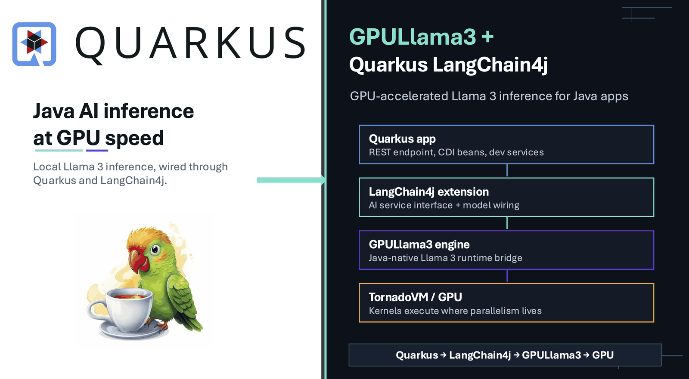


This article was first published on the TornadoVM blog on 15 June 2026. Since then, GPULlama3.java has been renamed [jitLLM](https://github.com/beehive-lab/jitllm) (latest release 3.1.0), and its Quarkus extension is now `quarkus-langchain4j-jitllm`, configured under `quarkus.langchain4j.jitllm.*`. The [JitLLM chat model documentation](https://docs.quarkiverse.io/quarkus-langchain4j/dev/jitllm-chat-model.html) has the current coordinates. TornadoVM has also supported GraalVM Native Image since 8.0.0.


How a collaboration between the University of Manchester and Red Hat brought GPU-accelerated LLM inference to the cloud-native Java stack, no Python or CUDA required.

If you're a Java developer who has ever tried to add a large language model to your application, you know the usual story: the moment GPUs enter the picture, you're pulled into a Python world of PyTorch, CUDA toolkits, and a separate microservice glued onto the side of your otherwise tidy Java stack. You end up maintaining two ecosystems, two deployment pipelines, and two sets of headaches.

As part of the EU-funded [AERO project](https://aero-project.eu/), the University of Manchester (UNIMAN) and Red Hat (RHAT) teamed up to remove that friction entirely. The result lets you run modern LLMs directly on your GPU, written in pure Java, from inside a standard Quarkus application — using the same programming model you'd use for any cloud-hosted model.



*Quarkus → LangChain4j → GPULlama3 → GPU.*

## The two pieces of the puzzle

The integration brings together two open-source projects that were each strong on their own.

- **[GPULlama3.java](https://gpullama3.dev/)** is UNIMAN's GPU-accelerated LLM inference engine. It runs Llama3-style transformer inference in pure Java and automatically offloads the heavy math to your GPU through [TornadoVM](https://www.tornadovm.org/), which supports OpenCL, PTX/CUDA, and SPIR-V backends. It builds on the [Llama3.java](https://github.com/mukel/llama3.java) project, reads models in the standard GGUF format, and falls back to a lightweight CPU path when no GPU is available. You can read more on the [TornadoVM GPULlama3 page](https://www.tornadovm.org/gpullama3) and grab the code on [GitHub](https://github.com/beehive-lab/GPULlama3.java).
- **[Quarkus-LangChain4j](https://github.com/quarkiverse/quarkus-langchain4j)** is the open-source extension that wires LangChain4j into Quarkus. It exposes models as CDI-injectable beans (`ChatModel` and `StreamingChatModel`) and through declarative AI Services, with everything configured through ordinary Quarkus properties.

The synergy is simple but powerful: UNIMAN's engine was made into a **first-class inference-engine provider** inside [Quarkus-LangChain4j](https://github.com/quarkiverse/quarkus-langchain4j/tree/main/model-providers/jitllm). So GPU-accelerated, locally hosted inference is now available to any Quarkus app through exactly the same API you'd use for OpenAI, Ollama, or any other provider.

## Why this matters

Putting the engine behind the Quarkus-LangChain4j abstraction unlocks a few things that Java teams have wanted for a long time:

- **Privacy by default.** Your data never leaves your servers. For teams in healthcare, finance, or government bound by GDPR or similar rules, that's often the difference between shipping and not shipping.
- **No per-token bill.** You run on your own GPU (or CPU), so there's no metered API in the loop.
- **One language, one stack.** No Python sidecar, no separate deployment, no second ecosystem to keep patched.
- **Real hardware performance.** TornadoVM JIT-compiles the hot paths down to the GPU, so you get accelerated inference without leaving the JVM.

## What it looks like in practice

Adding GPU-accelerated inference to a Quarkus project starts with a single dependency:

```
<dependency>
    <groupId>io.quarkiverse.langchain4j</groupId>
    <artifactId>quarkus-langchain4j-gpu-llama3</artifactId>
    <version>1.10.0</version>
</dependency>
```

Then you pick your engine and GGUF model in `application.properties`:

```
quarkus.langchain4j.gpu-llama3.enable-integration=true
quarkus.langchain4j.gpu-llama3.chat-model.model-name=unsloth/Llama-3.2-1B-Instruct-GGUF
quarkus.langchain4j.gpu-llama3.chat-model.quantization=F16
quarkus.langchain4j.gpu-llama3.chat-model.temperature=0.7
quarkus.langchain4j.gpu-llama3.chat-model.max-tokens=1024
```

The model files are downloaded automatically from the Beehive Lab Hugging Face collections if they aren't already cached locally. After that, an injected `ChatModel` works just like any other Quarkus bean — except the inference runs on your GPU through TornadoVM:

```
@Path("chat")
public class ChatLanguageModelResource {
    private final ChatModel chatModel;

    public ChatLanguageModelResource(ChatModel chatModel) {
        this.chatModel = chatModel;
    }

    @GET
    @Path("blocking")
    public String blocking() {
        return chatModel.chat("When was the Nobel Prize for economics first awarded?");
    }
}
```

If you'd rather stream tokens as they're generated — ideal for chat UIs — there's a `StreamingChatModel` bean that does exactly that.

***One thing to keep in mind:*** you must pass the TornadoVM argument file to the JVM when you build and run, because the engine relies on TornadoVM:

```
mvn clean package
java @$TORNADOVM_HOME/tornado-argfile -jar target/quarkus-app/quarkus-run.jar
```

Two current constraints are worth flagging up front: i) you'll need **Java 21 or Java 25**, and ii) the GPU path runs on the JVM since TornadoVM doesn't yet support GraalVM Native Image.

## One integration, many models

A nice payoff of plugging in at the provider level is that a single integration serves a whole catalogue of models rather than just one. Through GPULlama3, the provider can load and run several GGUF model families — with full FP16 support and partial Q8_0 / Q4_0 quantization:

| Model family | Quantization Support |
|---|---|
| Llama 3.1 / 3.2 | FP16, Q8_0 |
| Mistral 7B | FP16, Q8_0 |
| Qwen2.5 | FP16, Q8_0 |
| Qwen3 | FP16, Q8_0 |
| Phi-3 (Mini 4k / 128k) | FP16, Q8_0 |
| DeepSeek-R1-Distill-Qwen | FP16, Q8_0 |
| IBM Granite 3.2 / 3.3 | FP16, Q8_0 |
| IBM Granite 4.0 | FP16, Q8_0 |

## Try it yourself

There's a set of ready-to-run demos — a blocking chat service, a token-streaming service, and a summarisation service — that show the whole thing working end to end:

- **Demo applications:** [github.com/beehive-lab/gpullama3-quarkus-langchain4j-demo](http://github.com/beehive-lab/gpullama3-quarkus-langchain4j-demo)

- **Provider documentation:** [Quarkus-LangChain4j GPULlama3 chat model](https://docs.quarkiverse.io/quarkus-langchain4j/dev/jitllm-chat-model.html)

- **Collection of supported Models:** [https://huggingface.co/beehive-lab/collections](https://huggingface.co/beehive-lab/collections)

